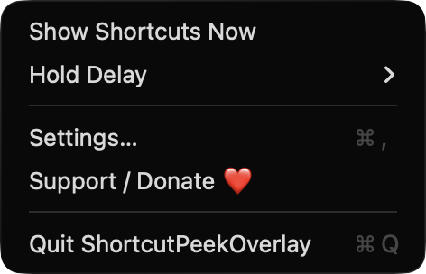
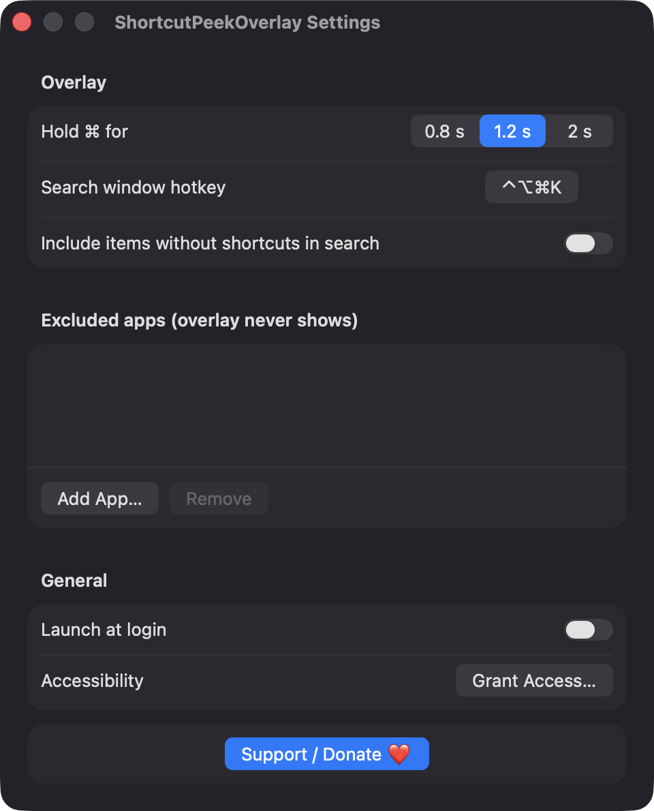

# ShortcutPeekOverlay

**🌐 Website:** [turhe123.github.io/shortcut-peek-overlay](https://turhe123.github.io/shortcut-peek-overlay/)

Hold Command for a moment and see every menu shortcut of the frontmost app in a searchable overlay.


## Why

Paid shortcut helpers in the *Focus & Productivity* category, such as KeyCue ($19.99 one-time, sale price seen), showed that many people want to learn an app's shortcuts without reading a manual. ShortcutPeekOverlay is a free, open-source, 100% native, backend-free take on the same hold-to-reveal idea, with search added.

## Features

- **Hold ⌘ to peek.** Hold Command alone for a configurable delay (0.8 s, 1.2 s default, or 2 s) and a centered overlay lists the frontmost app's menu shortcuts. Release Command and it disappears.
- **No false triggers.** The hold is cancelled if any other key, modifier, mouse click or scroll happens, so ordinary shortcuts like ⌘C never flash the overlay.
- **Grouped by menu.** Items are grouped by top-level menu (File, Edit, View…) in menu-bar order, shown as keycap glyphs (⌃ ⌥ ⇧ ⌘, arrows, F-keys, Space, ⌫ and so on). Disabled items are dimmed.
- **Adaptive layout.** Hold mode uses up to five columns depending on screen width and content, on the screen where the mouse is.
- **Searchable mode.** A global hotkey (default ⌃⌥⌘K, re-recordable in Settings) or **Show Shortcuts Now** in the menu bar opens a search window. Type to filter by item or menu name, use ↑/↓ to select, press Return (or click) to run the item, Esc to close.
- **Run menu items.** In search mode the selected item is triggered through the Accessibility `AXPress` action.
- **Favorites.** Star items to pin them to the top, per app. Favorites also appear first in hold mode.
- **Optional extras in search.** A toggle includes menu items that have no shortcut.
- **Excluded apps.** Pick apps where the overlay never shows.
- **Secure input aware.** The hold overlay is skipped while secure input is active (e.g. password fields).
- **Fast and forgiving.** Menus are read on a background task with a 1.5 s timeout (partial results are shown with a note) and cached for 5 seconds per app. Apps that expose little through Accessibility get a polite note.
- **Menu bar app.** Hold-delay picker, Settings, Support and Quit live in a menu bar extra. Optional launch at login.

## Screenshots

<p align="center"></p>

<p align="center"><em>The ShortcutPeekOverlay menu bar menu, with Show Shortcuts Now, the hold-delay picker, Settings, Support and Quit.</em></p>

<p align="center"></p>

<p align="center"><em>Settings, where you choose the ⌘ hold delay, record the search hotkey, pick excluded apps and turn on launch at login.</em></p>

## Install

1. Download `ShortcutPeekOverlay-macOS.zip` from the [latest release](https://github.com/turhe123/shortcut-peek-overlay/releases/latest).
2. Unzip it and move `ShortcutPeekOverlay.app` to `/Applications`.
3. Because the app is open source and not notarized, clear the quarantine flag:

   ```bash
   xattr -cr /Applications/ShortcutPeekOverlay.app
   ```

4. The first time, right-click the app and choose **Open**.

## Build from source

Requires macOS 14+ and Xcode with Swift 5.9+.

```bash
brew install xcodegen
xcodegen generate
xcodebuild -project ShortcutPeekOverlay.xcodeproj -scheme ShortcutPeekOverlay -configuration Release -derivedDataPath ./build build
```

The app is produced at `build/Build/Products/Release/ShortcutPeekOverlay.app`.

## Permissions

- **Accessibility** (required). Used to read the frontmost app's menu bar and shortcuts, to press the chosen item in search mode, and to listen for the Command hold and the global hotkey with a listen-only event tap. The app prompts for it and keeps retrying until it is granted. Enable it in System Settings › Privacy & Security › Accessibility.
- **Login item** (optional). Only if you turn on "Launch at login", via `SMAppService`.

The app does not request Screen Recording, Microphone, Camera or any other permission, and it makes no network connections. The event tap is listen-only: it observes key and mouse events to detect the hold and hotkey, never modifies or blocks them, and does not record or store keystrokes. Depending on your macOS version, the system may also show the app in the Input Monitoring list.

## Built with AI

ShortcutPeekOverlay was written by [Claude Code](https://claude.com/claude-code) inside an automated pipeline, from a plain-English spec. No code, binaries or assets from any commercial app were used; it is a clean-room reimplementation of a feature set, not a copy.

What that means in practice:

- The full source is in this repo under the MIT license. Read it before you run it.
- No network calls, no analytics, no third-party dependencies. Only Apple frameworks.
- Ad-hoc signed and not notarized, which is why Gatekeeper warns on first launch.
- It has had less human review than a hand-written app. Bug reports and pull requests are welcome.

## Support ❤️

If this saves you a few minutes, you can support the project:

[Support Or (Leo) Davidai ❤️](https://ko-fi.com/leodavidai)

## License

MIT © Or Davidai Bachar

## More free Mac apps

Prefer something that runs in the browser? The same pipeline builds [free, private web tools](https://turhe123.github.io/web-tools/): PDF, image, developer, data and audio tools, nothing uploaded.
